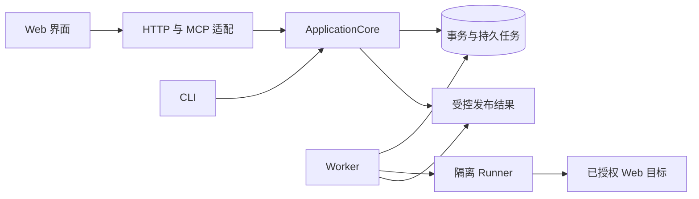

# 架构与职责

界鉴将权限要求与真实 Web 行为对应起来。系统需要同时维护人工批准的规则、可追溯执行事实和确定性结论；界面、模型建议与执行机制都不能越过这些事实的所有者。

## 一次检查如何形成结果

入口负责严格解析、来源与授权检查、错误映射。ApplicationCore 组织用例：读取当前规则与材料，预览范围，核对指纹并提交持久任务。Worker 领取任务后，交由隔离 Runner 执行目标操作。结果通过严格 reader 核对来源和关联，领域验证据此形成结论，再发布供报告读取。

提交成功、任务完成、结论成立和报告发布分别有事实。任何一层都不能以“接口返回成功”替后续阶段作保证。

## 模块所有权

| 位置 | 拥有的职责 | 依赖边界 |
| --- | --- | --- |
| `product/backend/domain` | 生命周期、领域约束、确定性验证 | 不依赖 HTTP、SQL、浏览器与 UI |
| `product/backend/application` | 接入、规则、准备、检查、修改与授权用例 | 接收工作单元及受控服务；外部运行通过端口协调，不复制控件状态 |
| `product/backend/infrastructure` | 存储、秘密、进程、浏览器与产物机制 | 不自行批准规则或决定结论 |
| `product/backend/interfaces` | HTTP、MCP、CLI 与独立 Worker 命令输入输出 | 调用组合根和用例，不内嵌第二套业务逻辑 |
| `product/backend/bootstrap` | ApplicationCore 和实际依赖装配 | 明确启动与释放所有权 |
| `product/protocols` | 独立持久化与跨进程根格式 | 严格 reader 与明确版本支持 |
| `product/frontend/src` | 任务导航、页面组合、实体读取和交互 | 展示服务事实，不重新计算安全结论 |
| `product/launcher/windows` | 随发行运行的 Windows 启动器、启动脚本、品牌与许可 | 只接通包内运行环境和统一 CLI，不安装依赖或拥有业务状态 |
| `scripts` | 环境、构建、验证和参考生成 | 不拥有产品业务状态 |

同一事实只有一个主所有者。新增文件按共同变化的原因拆分，不能只为缩短文件增加转发层。内部模块移动须同步真实装配、动态注册、包资源与消费者；历史迁移和公共格式的兼容责任另行处理。

## 子目录如何归属

前端、用例和存储可以出现相同业务名称，它们分别拥有展示、用例和持久事实。判断重复应核对是否实现了相同规则，而非只比较文件夹名。

| 边界 | 子目录组织 |
| --- | --- |
| 前端 `app`、`pages`、`entities`、`shared` | 应用装配、完整任务、实体契约、无业务基础设施逐层依赖；业务页不互相导入。模块行为测试就近维护，构建、测试初始化和编辑器实现归前端的 `tooling` |
| `application` | 按接入、业务边界、准备、录制、检查、修改、身份、示例和工作区分用例；准备中的绑定、证明、补充材料与引导各自拥有前置条件，检查中的读取与复验分别维护 |
| `domain` | 按业务概念维护规则和纯判断；人工审阅、建议及其依赖范围由 `boundaries/candidate_reviews.py` 共同维护，跨用例身份指纹由 `identities/models.py` 唯一定义 |
| `infrastructure/storage` | 按应用、业务边界、准备、执行、结果、修改、运行和设置组织表与仓储；事务、连接和 ORM 登记集中维护 |
| `infrastructure/runtime` | 运行任务、进程身份与进程树、Worker 监督以及三类隔离 Runner 分工；任务端口与目标注册分离，处理器不反向装配注册表 |
| `infrastructure/recording` | 浏览器事件、脱敏、控制文件、请求保存及不可变 Flow 读写；用例决定何时接受，文件机制核对路径、摘要和原子发布 |
| `infrastructure/observers` | 通用协调、具体来源适配、受控记录读取与逐 Case 观察分别维护；私有对照投影属于 `checks/models.py`，不要求反向导入运行协调器 |
| `infrastructure/artifacts` | 检查包、来源扫描、证明与参照产物；只有具有独立职责的子组才建目录，不为报告或 Runner 预建空占位层 |
| `interfaces` 与 `bootstrap` | HTTP 中的 MCP 和路由按入口组织，CLI 与 Worker 是并列进程入口；组合根装配服务，基础设施不反向导入它们 |
| `protocols` | 按检查、准备、录制、运行、Runner、Observer、Web 与报告的独立 reader 组织根格式；`schemas` 是对应注册生成物，分组不要求逐文件镜像 Python 模块 |
| `tests` | 按被保护的所有者划分；跨模块构造器、假目标和独立预期放入 `support`，局部辅助仅在所属模块复用，测试用例不成为其他能力的夹具入口 |
| `scripts` | 按开发准备、发行构建、文档和验证组织，源码启动属于开发工具；随产品运行的启动器归 `product/launcher`，可执行示例归 `samples`，前端编辑器实现归前端工具 |
| `docs` 与配置 | 产品任务、工程机制和声明参考分别组织；工具链由 `product/config` 定义，运行与第三方依赖缓存进入运行目录，不成为源码模块 |

不为文件数量对称而建目录。全局单文件配置与入口可直接留在所属根；只有独立资源、稳定命名空间或共同变化的实现才使用子目录。依赖图不形成运行时回环，纯类型引用不参与运行图。公共协议可复用领域词汇，领域判断可消费冻结的协议事实；具体模块仍保持单向引用，不以延迟导入掩盖相互装配。

当前用例直接使用部分仓储和被注入的基础设施服务，并非完全隔离的纯端口架构。外部目标运行必须通过受控执行边界；纯判断留在领域层。继续抽取端口需要真实的可替换实现或独立契约，不能为让目录图整齐增加无行为转发层。

删除实现前，从实际入口、注册表、组合根和框架发现核对消费者。独立算法、历史 reader、迁移和框架回调有各自入口；单次文本搜索没有引用，不足以证明死代码。替换完成后同时清理失效的导入、参数、样式和专属设施；仍有效的业务断言按[迁移取舍](体系迁移与取舍.md)承接。

## 读取与执行的不同寿命

工作区投影用于汇总，不充当执行授权。准备页直接读取轻量准备投影，避免等完整历史才能显示当前缺口。同一次只读投影按服务和精确输入复用结果，并返回独立副本；请求结束或异常后释放，不能演变成跨请求的陈旧门禁缓存。

预览依据当前事实形成计划。提交重新核对指纹，执行使用冻结输入；不能用页面缓存拼成新计划。历史报告读取当时发布事实，不随当前规则和材料变化。

进度、诊断、统计和动画只投影事实或使用独立展示资源，不能消耗正式序号、执行预算、重试次数、随机源和租约，也不能改变 canonical、hash 输入或安全结论。用户看到终态后，相关页面状态应重新收敛到后端权威事实。

## 失败与资源清理

API lifespan 和 bootstrap 管理本进程资源；持久任务的租约、fence、取消和实际停止各自留痕。退出时继续尝试停止各个独立进程所有者；任一停止失败就保留共享凭据、数据库与运行目录，供诊断和重试。只有进程均已确认停止，才进入共享资源释放。UI 关闭或取消按钮被接受，不足以证明 Worker 和目标进程已经结束。

扩展能力前写清输入、前置条件、事务、结果发布、回执未知与退出路径，再决定目录。协议和事务细节见[协议与持久化](协议与持久化.md)，页面机制见[前端实现](前端/实现.md)。

长期选择及代价见[设计决策](设计决策.md)，数据所有权与发布恢复见[协议与持久化](协议与持久化.md)。
