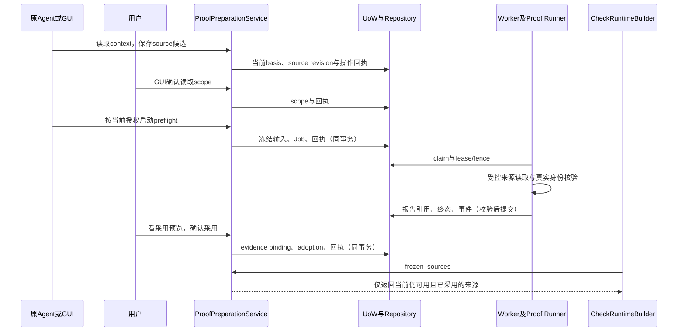

# 证明来源

本页面向维护者，说明能力协作、持久事实、拒绝边界和恢复方式。用户操作从[文档入口](../../README.md)选择；源码定位查[模块索引](../../参考/模块索引.md)。

## 证明来源

### 官方示例与集中准备

官方示例提供“准备示例材料”。确认页说明固定的 curator/judge、campus、操作/恢复步骤、ZIP/PDF 文件和只读业务记录。确认后完成账号与候选准备，再逐项授权、启动独立预检查、读取回执并采用可用材料；正式检查仍另行启动。任何自定义集合、资源、身份或路径超出确认范围时停止，不把官方入口当成任意来源的自动授权。

普通应用由 Agent 保存候选。界面“核对整批材料”展示实际应用地址、账号、资源、读取路径、预算与文件入口；用户勾选确认后续接同一准备流程。确认后 basis、来源修订或配置变化时必须重新审阅。缺文件、预检查失败或未知写入停止后续步骤，保留已完成项目；返回页面不会自动重发。离开页面后已批准批次继续由后台推进，再次打开可查询原批次；重启或撤权后停止新的步骤。

`product/backend/application/preparation/batches.py` 持久化 GUI 确认的计划并复用既有命令。`product/frontend/src/pages/preparation/Preparation.tsx` 读取批次状态和轻量准备投影，不在浏览器逐条执行后台步骤。`product/frontend/src/pages/preparation/materials/Sources.tsx` 读取具体来源，分别处理范围确认、预检查与采用。

来源页按业务结果组织，明确测试资源、资源所有者、来源版本与证明方法。完整文件来源可以上传并确认参照，采用已登记参照仍须匹配动作、所有者与资源。读取授权、来源核对和检查采用分别显示状态；“核对读取范围”“预检查来源”“核对采用影响”按照当前条件出现。采用前核对影响和当前依据，不因材料看似齐备就省略门禁。

来源写入以固定操作标识处理，未知回执保留待查询操作，不自动重发。来源状态读取不可触发目标执行；长时间预检查进入任务。配置变化、资源失效或授权撤回后重新核对，不根据页面缓存恢复已失效授权。

### 一次来源怎样进入检查

图省略传输层和普通错误封装；API不在请求处理中发预检查目标流量。正式CHECK后来重新按冻结来源执行验证，本次预检查没有安全Verdict。

### 谁拥有事实

- `PreparationFacts` 是服务在本次事务中读取的边界、源码、账号、资源、运行和basis，只存在内存。
- `ProofSourceRevision` 保存来源配置及修订；`SourceReadScope` 保存用户确认的读取边界。配置不是授权，授权不是采用。
- `ProofPreflightJobs.submit` 复用调用方UoW，创建不可变预检查输入、Job与事件；外层 `_operation` 写入同一个操作回执并提交。
- `ProofPreflightJobs.publish` 先保存报告工件，再在写事务中校验请求、scope、报告内容及attempt/fence/lease，并关联report hash和完成Job。文件存在本身不表示发布接受。
- `adopt` 在同一个 `_operation` 事务中写入 `ActionEvidenceBinding`、采用记录和回执；确认前重新核对basis、source revision、runtime、报告与记录合同。
- `active_sources` 每次重新检查采用修订、binding指纹及有效预检查；新实例不能凭旧READY继续。`frozen_sources`供正式检查构建使用。

### 修改时保留的边界

1. 原Agent可以协助填写候选和启动获授权的预检查；正式权限、读取范围、采用由人确认。人的材料确认可逐项进行，也可对明确列出的清单集中进行；LLM 不能代替确认。GUI/MCP共用服务，不在工具或页面复制审批算法。
2. `_operation` 先取写锁、查project/kind/operation_id。相同输入返回已有回执，同键异文拒绝；不能把业务写入和回执拆开提交。
3. basis、scope、source revision、runtime instance、账号和资源的任何相关变化都必须重新核验；不能仅凭“上次USABLE”采用。
4. 撤销scope影响对应任务与后续采用；重新授予不能复活旧授权提交的任务。保持检查提交和运行时的各自核验。
5. CHECK根格式、canonical和冻结字段若要改变，先按公共协议流程决定；纯页面说明不得改变这些字段。

### 失败先查哪里

| 症状 | 先读的权威事实 | 正确恢复方向 |
| --- | --- | --- |
| 保存后网络响应未知 | 原项目、operation kind、operation_id的receipt | 页面只查原回执，不换新键重放；存储无法保留操作身份时阻止写请求 |
| 预检查USABLE但采用被拒绝 | `_adoptable`比较的source revision/basis/runtime/scope/contract | 找到失效依据后更新准备或重新预检查；不放松校验来消除提示 |
| Job已结束但页面还在轮询 | status、Job/report关联、useProofSources当前项目引用 | 修正事实回读/陈旧响应处理；不在页面伪造完成 |
| 撤权后任务仍显示运行 | job_authorized、scope、cancel请求与真实Job终态 | 核对取消与Runner收口；区分“已请求取消”和“已清理结束” |
| 新实例上旧来源不能用 | active_sources与当前runtime_reference | 同配置先重新核验新实例；修订变更需重新采用 |
| 报告工件存在但无可用结果 | ProofPreflightJobs.read中的DB引用、hash和Job关联 | 不绕过reader直接展示工件为成功，不重复执行目标试探 |

### 最小验证

- 只改来源采用条件：先选 `test_proof_sources.py`/`test_proof_reuse.py`相关用例，再加 `test_proof_check.py`的冻结消费者。
- 改撤权或basis：先选 `test_proof_fail_closed.py`，如果动到API/MCP授权，再加相应控制面测试。
- 只改未知回执UI：运行ProofSourcesPanel组件测试；核对项目切换、刷新、旧响应、持久化失败和已成功回读，不触发整个后端L4。
- 改跨进程格式：再加入协议、严格reader和publication直接测试。是否需要进程集成由真实改动决定。

正式后端和前端入口分别为 `dev.ps1 test`、`dev.ps1 frontend-test`，遵循验证规范的完整PowerShell调用。现有检查点按生产输入、测试和工具环境有效性复用。

### 创建后才有编号的对象

`CREATED_OBJECT_RECORDS` / `OBJECT_CREATION_V1` 用于业务结果为 `OBJECT_CREATION`、对象编号从 TARGET 响应提取的动作。Agent 保存来源候选；用户在原材料页面确认整个集合读取范围、预检查并采用。旧单资源授权不能覆盖集合读取，官方示例的固定自动准备也不能代为扩大范围。

- 业务对象必须实际由 `jiejian:records` 集合保存；自报JSON、额外写的审计日志和HTTP状态不能冒充独立存储。业务请求内的 `seed(resource_id, owner_id, data)` 由宿主注入请求scope，创建事实与对象同事务持久化。初始化和旧对象不补造请求创建事实。
- 恢复仍走已录制、已确认的应用接口和恢复账号。集合提供 `remove(resource_id, expected_version)`，应用须保留原有授权校验。恢复只注入本次独立证明的新编号，不使用样本编号；删除后编号不能复用，以免迟到的恢复请求误中另一次创建。
- Worker / Runner在SETUP后、TARGET前建立有限完整集合基线，核对实际身份，再执行唯一TARGET。集合最多256个对象、每请求最多32条创建/删除记录；超限报错，不截断后宣称完整。取证保存标识、归属、版本和摘要，不导出业务正文。
- 本次请求未创建对象时，不发送删除请求。已确认创建后又删除、返回403或传输失败，仍保留创建事实。闭合请求窗中没有创建才能证明未发生；响应编号错误、归属不明、并发影响、来源失效和恢复不明都不能得到PASS。
- 恢复前重新核对对象实例和集合；恢复后核对原集合完整投影。恢复失败停止后续Case，保留实际编号与原事实。202异步创建尚无完整终态证明时保持不确定，不把响应接受当成完成。
- 新来源/预检查根使用格式4，预检查Runner根使用格式3；正式运行、请求、证据分别使用格式7、6、3。旧根仍按原格式读取。已封存实际对象可从结果证据打开；复验以业务条件、集合、账号和创建证明标准匹配，不用每次新编号冒充换题。

界面验收应查看来源用途、集合授权和新对象证据三处；自动回归文件 `tests/infrastructure/execution/test_creation_check.py` 本轮仅补写，未运行。

### 文件参照与正常取样

文件后果使用 `REFERENCE_FILE` 来源。尚未产生文件时允许保存无参照的候选；读取授权、预检查与采用仍在原材料流程中完成。`ReferenceFilePreparation` 内嵌在该来源，提供已有测试文件上传和正常操作取样两种途径，取得文件后仍需人工核对含义。

- `artifact_inputs.py` / `ProofArtifactStore`：单份非空文件最多4MiB，单项目64份活动输入、256MiB；PENDING预留容量。字节只写私有文件，公共数据保存归属、大小和摘要。已被来源或检查引用的文件不能移除。
- `capture_plan.py` / `capture_service.py`：GUI预览、一次授权、原操作回执；需匹配正常ALLOW规则、实际账号、测试资源、录制和恢复。预览不执行业务操作。
- `capture_jobs.py` / `capture_runner`：REFERENCE_CAPTURE进入原Worker及独立Runner，TARGET最多一次。Flow前保存资源起点，完成后核对恢复；文件、报告和数据库发布各自校验，封存后中断仅补原发布。
- 恢复不明时，`capture_recovery_gaps`使原Preparation中同资源项阻塞。GUI“核对并恢复”沿原起点运行，只恢复、不重复TARGET、不产生新参照。Generation或原材料不匹配则保留缺口。
- 独立根见 `product/protocols/preparation/proof_artifacts.py`、`reference_capture.py`。任务、资产和恢复关联由当前完整数据库基线建立。

直接验证：`test_reference_capture.py`覆盖上传/取样→采用→真实CHECK、取消、恢复失败及不重发目标、发布中断；`test_proof_artifact_inputs.py`覆盖字节和容量边界。前端组件及 `tests/application/preparation/proofs/test_reference_capture.py`核对当前产品页面。

[来源契约](#证明来源契约)、[来源协作](#来源协作)、[MCP授权](控制面与授权.md)、[运行加载](应用与运行.md)。

## 来源协作

### 调用、读写与确认

| 阶段 | 调用者→拥有者 | 读取 | 写入/输出 |
| --- | --- | --- | --- |
| context与候选 | GUI/MCP→ProofPreparationService | 当前规则、源码、账号、资源、runtime及basis | 候选revision与回执；context本身只读 |
| 读取授权 | GUI人的决定→grant_scope | 当前候选与实例、路径/身份/资源/预算 | SourceReadScope与回执 |
| preflight提交 | 获授权GUI/MCP→start→ProofPreflightJobs | scope、当前执行权限、真实账号引用、记录contract | 冻结输入、Job、事件和操作回执同UoW |
| 执行与报告 | Worker→Proof Runner→publisher | 冻结输入、最小秘密、当前lease/fence | 严格报告工件与经校验的DB引用/终态 |
| 采用 | GUI人→adoption_preview/adopt | 当前basis/revision/runtime/scope、USABLE报告及实际contract | evidence binding、adoption和回执同事务 |
| 检查 | CheckRuntimeBuilder→frozen_sources | active_sources重验当前采用依据 | CHECK runtime中冻结的来源配置与contract |

配置和scope不能互相替代；报告USABLE也不自动产生adoption。`PreparationFacts`只承载本次读取事实，不成为新持久化模型。

### 三处必须共同保留的拒绝边界

1. start核对当前读取scope与执行权限，冻结本次输入。
2. 执行授权与publish核对原scope和Job责任；scope撤销不能让旧执行者发布有效成功。
3. adopt/active_sources核对当前revision、basis、runtime和实际记录contract；旧成功报告不能越过变化。

scope撤销请求取消相应活动Job；重新授权不会复活原任务。控制面重启后读取历史采用记录仍需新的当前依据；允许沿用的旧配置必须重新预检查新实例。历史结果保持不变。

### 未知和收尾

`_operation`统一写锁、同键请求指纹、业务结果和准备回执。网络未知只读原project/kind/operation_id；前端存储不了操作身份时阻止请求。报告文件存在不表示Job收据已提交，读端必须校验全关联。执行失败、取消和清理沿[执行架构](Web执行与观察.md)处理，不用API重新读取目标试探。

定位源码及直接测试查修改证明来源，完整root/reader与兼容规则查[证明来源契约](#证明来源契约)。

## 证明来源契约

### 支持范围与根文档

当前新的完整来源使用AtomicProofSourceConfig和受控Node事务记录组件。记录必须由组件形成，任意自报JSON即使字段齐全也不能作为完整历史。TRANSACTION_HISTORY_V2核对受保护状态变化，RESOURCE_FIELDS_V1核对受保护投影读取；读取前提、身份、资源与effect种类必须匹配已确认规则。

模型位于 `product/protocols/preparation/proof_sources.py`；通用记录边界位于 `product/protocols/runtime/transaction_records.py` 与 `product/backend/infrastructure/observers/records/`。准确根和版本查[注册与格式](../../参考/模块索引.md)。

| 事实 | writer | 独立reader/消费者 | 生命周期 |
| --- | --- | --- | --- |
| ProofSourceRevision | ProofPreparationService.save | source/show、采用与冻结来源 | 候选追加修订；expected_revision防止覆盖 |
| SourceReadScope | GUI的grant_scope/revoke_scope | preflight提交/执行授权/发布/采用 | 有限origin、路径、账号、资源和预算；撤权使旧授权失效 |
| ProofPreflightInput | service.start＋ProofPreflightJobs.submit | 独立Proof Runner与报告关联校验 | 与Job/回执同事务冻结，不重新解释可变候选 |
| ProofPreflightReport | 独立Runner；Worker校验发布 | ProofPreflightJobs.read、_adoptable | 工件hash与Job/attempt/fence/请求关联；USABLE仅为技术核验 |
| ProofSourceAdoption | GUI显式adopt | active_sources、正式CHECK构建 | 与ActionEvidenceBinding和操作回执同事务；来源变化需重新确认 |
| FrozenProofSource | frozen_sources | CHECK runtime bundle和受控观察 | 冻结事务、文件或对象创建配置及其实际记录契约 |

### 冻结与确认

context从正式边界、源码、账号会话、资源与运行实例派生basis。保存、读取授权、预检查和采用分别核对各自输入依据；不能把一次context读取当成后续永久授权。

start在当前scope和EXECUTE授权内冻结预检查输入，经Worker/Runner读取真实身份、角色、资源所有者、字段与记录contract。API不执行该目标读取。report发布还核对scope、请求指纹、时间、必需核验项及当前attempt/fence/租约；已有工件不表示数据库已接受。

采用前预览明确资源集合、映射、受保护字段或状态、会替换的binding。adopt再次核对当前basis、source revision、runtime_reference、报告USABLE、scope与实际source contract；然后同事务写入binding、adoption和receipt。不创建另一套准备READY或安全结论。

### 回执、撤权与复用

准备写操作通过 `_operation` 在写锁内先查project/kind/operation_id。相同请求返回原回执，同键异文拒绝。网络响应未知只查询原键；未找到成功回执不等于操作未执行。

撤销scope时请求取消对应活动preflight。执行授权还核对当前控制会话、MCP临时权限和原scope；重新授权不能复活原任务。正式检查的来源冻结和运行核验仍是各自的边界。

同一来源配置在新实例上可以重新预检查后沿用既有采用记录，但active_sources必须核对当前修订、binding指纹及当前实例的有效报告。来源修订变化要求重新采用。旧来源格式不再提供兼容 reader。来源修订、授权、预检查输入和报告使用当前明确的根身份，仓储与跨进程 writer 均采用统一确定性编码。

### 失败与验证

旧basis、source revision、账号/资源、运行、scope或contract失配时停止；Job终态、技术assessment与权限Verdict分开。报告缺字段或关联不一致不能展示为成功；清理/取消收口按通用执行生命周期。

直接验证：`tests/application/preparation/proofs/`、`tests/contracts/http/preparation/test_proof_preparation.py`及对应协议/Runner测试。修改定位见[证明来源指南](#证明来源)，跨模块关系见[来源协作](#来源协作)。

记录组件使用完整的当前日志基线，加载时核验格式和完整结构，不再自动导入旧日志。截断、哈希链损坏或结构不匹配时保持封闭；不能把不可读取的尾部解释为业务效果未发生。
