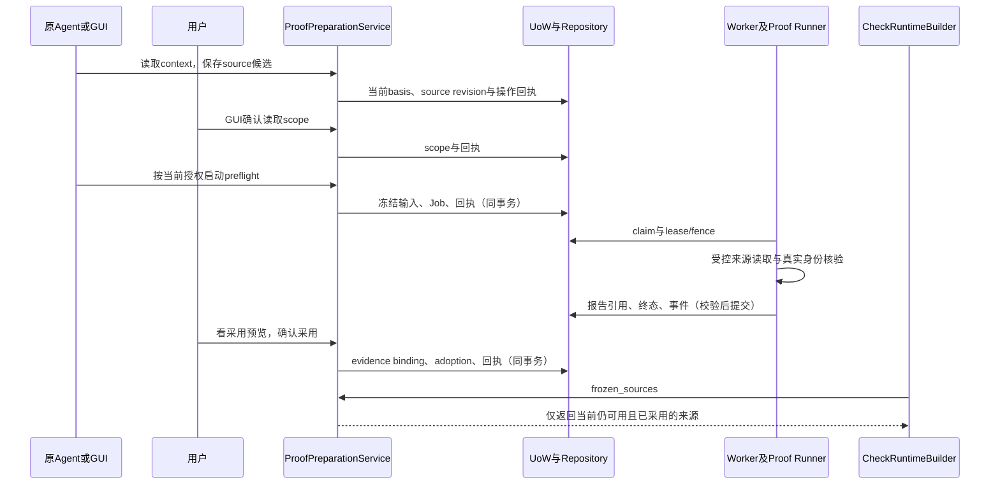

# 修改证明来源

> 状态：CURRENT。说明当前能力的唯一所有者、修改位置、直接消费者与验证。

这篇处理证明来源配置、读取授权、独立预检查、采用、撤权和响应未知后的恢复。主要所有者是 `product/backend/workflows/preparation/proofs/service.py::ProofPreparationService`。

如果只是某个材料被判失效，先查 `product/backend/workflows/preparation/bindings/sources.py::BindingSourceInspector`；如果要改PASS/BLOCK规则，进入权限判断指南。证明预检查的USABLE只表示技术准备条件成立。

GUI 从检查准备进入“准备检查用的文件和记录”；当前任务也可给出精确材料入口。逐项准备保留读取授权与采用的独立操作；集中准备允许人在一个明确清单中同时确认读取和后续采用，再顺序调用这些原命令。未知回执继续使用原操作读取。

## 官方示例与集中准备

官方示例提供“一键准备示例材料”。确认页说明固定的 curator/judge、campus、操作/恢复步骤、ZIP/PDF 文件和只读业务记录。确认后完成账号与候选准备，再逐项授权、启动独立预检查、读取回执并采用可用材料；正式检查仍另行启动。任何自定义集合、资源、身份或路径超出确认范围时停止，不把官方入口当成任意来源的自动授权。

普通应用由 Agent 保存候选。界面“核对这批材料”展示实际应用地址、账号、资源、读取路径、预算与文件入口；用户勾选确认后续接同一准备流程。确认后 basis、来源修订或配置变化时必须重新审阅。缺文件、预检查失败或未知写入停止后续步骤，保留已完成项目；返回页面不会自动重发。离开页面后已批准批次继续由后台推进，再次打开可查询原批次；重启或撤权后停止新的步骤。

`workflows/preparation/batches.py` 持久化GUI确认的计划并复用既有命令；`usePreparationBatch.ts`只订阅，不再在页面里编排写入。来源页使用 `?view=sources` 轻量读取；完整建议仍由默认接口供材料协作与 MCP 使用。同步核验路由在线程池执行，异步上传只负责读取请求体，后续处理也交给线程池。轮询不重叠，子页面显示时停止父材料轮询；写入回执确认后返回按钮不等待外层刷新。

页面先说明所选业务结果及其证明方法。文件接收说明完整测试文件怎样用于实际内容比对；提交记录说明怎样核对实际变化；字段读取说明怎样核对受保护内容。文件准备使用同级选择卡切换“让界鉴获取测试文件”和“使用已有测试文件”，突出当前方式的主操作；正常获取先预览，明确勾选后才执行。普通应用的技术配置默认收在高级区域；官方示例使用随材料准备的配置。已有示例文件先展示下载核对入口，采用弹窗明确测试对象、结果与保存的证明办法，采用后收起技术核对明细。参照、读取授权、预检查和采用仍沿原流程分别核对，不因文案和布局调整省略门禁。

## 快速找到修改位置

| 要改什么 | 主要位置 | 必须一起核对 | 直接测试 |
| --- | --- | --- | --- |
| 上下文、配置依据、旧修订拒绝 | `product/backend/workflows/preparation/proofs/service.py` 的 context、_facts、_current、save | commands模型、GUI/MCP输入、来源revision与basis | `tests/backend/workflows/preparation/proofs/test_proof_sources.py` |
| 读取scope、撤权与取消 | 同服务的 grant_scope、_scope_matches、revoke_scope、job_authorized | MCP授权回调、Job取消、发布时scope复核 | `tests/backend/workflows/preparation/proofs/test_proof_fail_closed.py` |
| 提交/读取/发布预检查 | `product/backend/workflows/preparation/proofs/jobs.py::ProofPreflightJobs` | proof_runner、Job attempt/fence、ProofReportStore | 上述fail_closed与 `tests/backend/api/preparation/test_proof_preparation.py` |
| 采用条件与运行复用 | service.py 的 _adoptable、adopt、active_sources、frozen_sources | evidence binding、runtime_bundle与受控记录契约 | `tests/backend/workflows/preparation/proofs/test_proof_reuse.py`、`test_proof_check.py`（同目录） |
| 真实记录与来源合同 | `product/backend/infra/observers/records/source_contracts.py` | 受控实例、通用记录组件、冻结contract与Runner观察 | Observer、运行加载及proof相关直接测试按实际改动选取 |
| 未知响应、刷新恢复、项目切换 | `product/frontend/src/features/preparation/proof-sources/useProofSources.ts`、`proofSourceOperations.ts`（同目录） | `ProofSourcesPanel.tsx`、原项目键、后端receipt(project,kind,operation) | `product/frontend/src/features/preparation/proof-sources/ProofSourcesPanel.test.tsx` |
| GUI/MCP调用入口 | `product/backend/api/routers/preparation/proof_sources.py`、`product/backend/api/mcp/preparation.py` | 共用service与严格commands；MCP不代人grant/adopt | `tests/backend/api/preparation/test_proof_preparation.py`、`tests/backend/api/system/test_mcp.py` |

## 一次来源怎样进入检查

图省略传输层和普通错误封装；API不在请求处理中发预检查目标流量。正式CHECK后来重新按冻结来源执行验证，本次预检查没有安全Verdict。

## 谁拥有事实

- `PreparationFacts` 是服务在本次事务中读取的边界、源码、账号、资源、运行和basis，只存在内存。
- `ProofSourceRevision` 保存来源配置及修订；`SourceReadScope` 保存用户确认的读取边界。配置不是授权，授权不是采用。
- `ProofPreflightJobs.submit` 复用调用方UoW，创建不可变预检查输入、Job与事件；外层 `_operation` 写入同一个操作回执并提交。
- `ProofPreflightJobs.publish` 先保存报告工件，再在写事务中校验请求、scope、报告内容及attempt/fence/lease，并关联report hash和完成Job。文件存在本身不表示发布接受。
- `adopt` 在同一个 `_operation` 事务中写入 `ActionEvidenceBinding`、采用记录和回执；确认前重新核对basis、source revision、runtime、报告与记录合同。
- `active_sources` 每次重新检查采用修订、binding指纹及有效预检查；新实例不能凭旧READY继续。`frozen_sources`供正式检查构建使用。

## 修改时保留的边界

1. 原Agent可以协助填写候选和启动获授权的预检查；正式权限、读取范围、采用由人确认。人的材料确认可逐项进行，也可对明确列出的清单集中进行；LLM 不能代替确认。GUI/MCP共用服务，不在工具或页面复制审批算法。
2. `_operation` 先取写锁、查project/kind/operation_id。相同输入返回已有回执，同键异文拒绝；不能把业务写入和回执拆开提交。
3. basis、scope、source revision、runtime instance、账号和资源的任何相关变化都必须重新核验；不能仅凭“上次USABLE”采用。
4. 撤销scope影响对应任务与后续采用；重新授予不能复活旧授权提交的任务。保持检查提交和运行时的各自核验。
5. CHECK根格式、canonical和冻结字段若要改变，先按公共协议流程决定；纯页面说明不得改变这些字段。

## 失败先查哪里

| 症状 | 先读的权威事实 | 正确恢复方向 |
| --- | --- | --- |
| 保存后网络响应未知 | 原项目、operation kind、operation_id的receipt | 页面只查原回执，不换新键重放；存储无法保留操作身份时阻止写请求 |
| 预检查USABLE但采用被拒绝 | `_adoptable`比较的source revision/basis/runtime/scope/contract | 找到失效依据后更新准备或重新预检查；不放松校验来消除提示 |
| Job已结束但页面还在轮询 | status、Job/report关联、useProofSources当前项目引用 | 修正事实回读/陈旧响应处理；不在页面伪造完成 |
| 撤权后任务仍显示运行 | job_authorized、scope、cancel请求与真实Job终态 | 核对取消与Runner收口；区分“已请求取消”和“已清理结束” |
| 新实例上旧来源不能用 | active_sources与当前runtime_reference | 同配置先重新核验新实例；修订变更需重新采用 |
| 报告工件存在但无可用结果 | ProofPreflightJobs.read中的DB引用、hash和Job关联 | 不绕过reader直接展示工件为成功，不重复执行目标试探 |

## 最小验证

- 只改来源采用条件：先选 `test_proof_sources.py`/`test_proof_reuse.py`相关用例，再加 `test_proof_check.py`的冻结消费者。
- 改撤权或basis：先选 `test_proof_fail_closed.py`，如果动到API/MCP授权，再加相应控制面测试。
- 只改未知回执UI：运行ProofSourcesPanel组件测试；核对项目切换、刷新、旧响应、持久化失败和已成功回读，不触发整个后端L4。
- 改跨进程格式：再加入协议、严格reader和publication直接测试。是否需要进程集成由真实改动决定。

正式后端和前端入口分别为 `dev.ps1 test`、`dev.ps1 frontend-test`，遵循验证规范的完整PowerShell调用。现有检查点按生产输入、测试和工具环境有效性复用。

## 按需深入

## 文件参照与正常取样

文件后果使用 `REFERENCE_FILE` 来源。尚未产生文件时允许保存无参照的候选；读取授权、预检查与采用仍在原材料流程中完成。`ReferenceFilePreparation` 内嵌在该来源，提供已有测试文件上传和正常操作取样两种途径，取得文件后仍需人工核对含义。

- `artifact_inputs.py` / `ProofArtifactStore`：单份非空文件最多4MiB，单项目64份活动输入、256MiB；PENDING预留容量。字节只写私有文件，公共数据保存归属、大小和摘要。已被来源或检查引用的文件不能移除。
- `capture_plan.py` / `capture_service.py`：GUI预览、一次授权、原操作回执；需匹配正常ALLOW规则、实际账号、测试资源、录制和恢复。预览不执行业务操作。
- `capture_jobs.py` / `capture_runner`：REFERENCE_CAPTURE进入原Worker及独立Runner，TARGET最多一次。Flow前保存资源起点，完成后核对恢复；文件、报告和数据库发布各自校验，封存后中断仅补原发布。
- 恢复不明时，`capture_recovery_gaps`使原Preparation中同资源项阻塞。GUI“核对并恢复”沿原起点运行，只恢复、不重复TARGET、不产生新参照。Generation或原材料不匹配则保留缺口。
- 独立根见 `product/protocols/preparation/proof_artifacts.py`、`reference_capture.py`；0015保存任务和资产，0016追加恢复字段，不改写已应用迁移。

直接验证：`test_reference_capture.py`覆盖上传/取样→采用→真实CHECK、取消、恢复失败及不重发目标、发布中断；`test_proof_artifact_inputs.py`覆盖字节和容量边界。前端组件及 `tests/acceptance/ui/reference_files.py`核对当前产品页面。

[来源契约](证明来源契约.md)、[来源协作](来源协作.md)、[MCP授权](../控制面/修改MCP与授权.md)、[运行加载](../应用接入/修改运行加载.md)。
